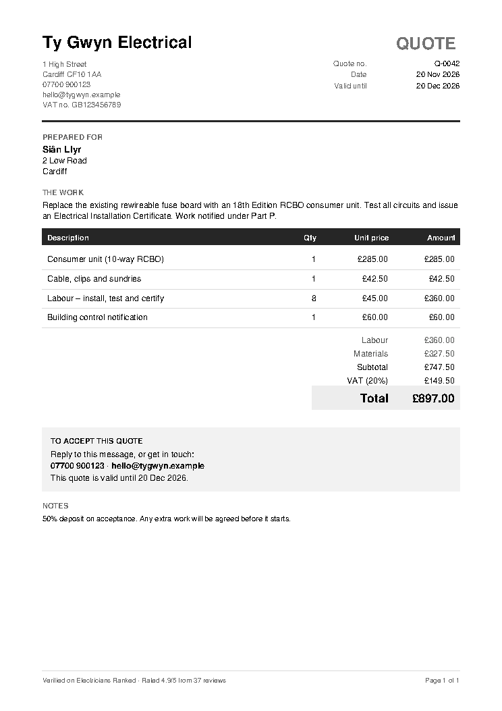
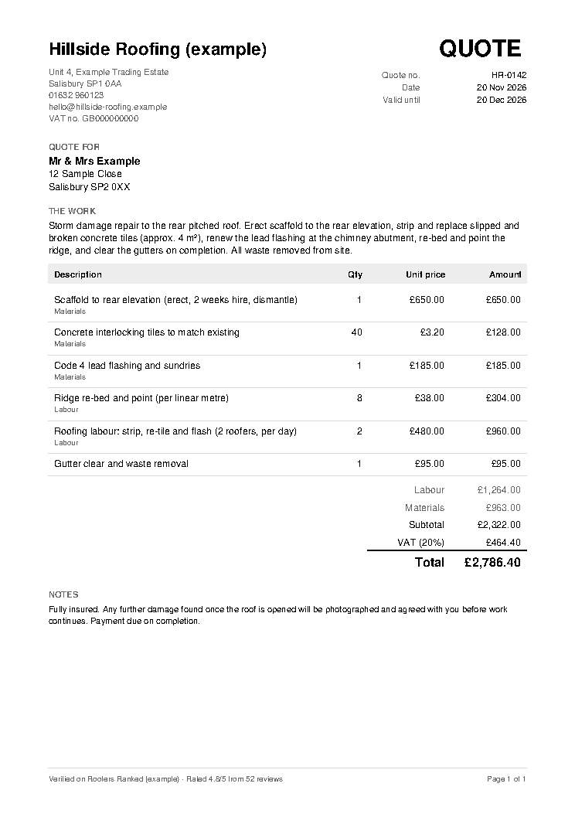
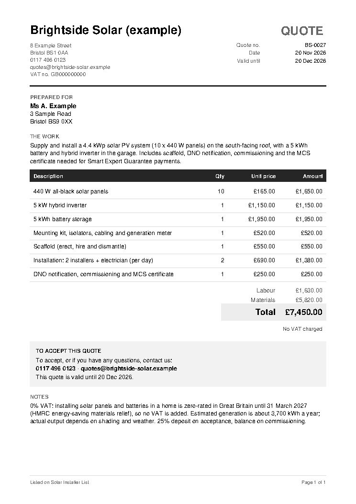

# Open Quote

**A free, open-source quote maker for UK tradespeople. Fill in a quote on your phone, get a branded PDF, and send it by WhatsApp or email.**

An alternative to building quotes from a Word or Excel quote template, and to job-management apps built for whole teams. It's made for electricians, plumbers, roofers, builders and other one-person trade businesses.

[](https://openquote.tradesites.ai/)
[](LICENSE)

### ▶ [Try the live demo: openquote.tradesites.ai](https://openquote.tradesites.ai/)

Open it on your phone and make a real quote. Nothing you type is stored: the server builds the PDF and forgets it.

**One-click example:** [open the demo with an example business, customer and quote already filled in](https://openquote.tradesites.ai/?utm_source=crm&utm_medium=email&utm_campaign=quote-follow-up#demo), then tap **Download PDF**. The link carries UTM tags, so you can see how campaign tracking survives.

Built and maintained by **[TradeSites](https://www.tradesites.ai/?utm_source=github&utm_medium=readme&utm_campaign=open-quote)**, which makes websites and follow-up systems for UK trades.

<p align="center"></p>

Open Quote does one job: it turns your prices into a clean, branded quote.

- **Unlimited quotes, no watermark, no account.**
- **Your branding:** your logo, contact details and VAT number on every quote.
- **Explain the job properly:** a free-text description of the work, line items tagged as labour or materials, and up to 3 photos.
- **UK VAT:** a 20% toggle, with a labour and materials breakdown. Money is calculated in whole pence, so totals never drift.
- **Send it your way:** the phone's share sheet (WhatsApp, email, Messages), or download it and send it yourself.
- **Trust line:** an optional footer such as "Verified on Electricians Ranked · Rated 4.9/5 from 37 reviews" that links to your listing.
- **Open it from your CRM:** a link can fill in the customer, the job and the prices, so a quote is one tap from your enquiry list. See [Prefill from a link](#prefill-from-a-link-crm).
- **Private by design:** the server builds the PDF and then forgets it. Your business details and your current draft stay on your own device.

## Why Open Quote exists

The quote is usually the first thing a customer sees from a trade business. In November 2026 we looked at reviews, trade forums and comparison sites to see how one-person trades produce quotes today. We found three common approaches, and a gap between them.

1. **A Word or Excel quote template.** It's free and familiar, but slow on a phone. The VAT sums are done by hand, and the result often looks homemade.
2. **Job-management apps** such as Tradify, ServiceM8, Jobber, Fergus and Powered Now. They're powerful, but built for businesses with office staff and several users. The complaints we saw repeatedly from sole traders were:
   - monthly per-user pricing that adds up;
   - more features than one person needs, and time spent learning them;
   - quote templates that are hard to customise, or can't include photos;
   - no offline use, which is a problem in lofts and on new builds;
   - sending that doesn't fit how customers talk to trades, which today is often WhatsApp.
3. **Free quote apps.** They exist, but many cap the number of quotes each month or add their own branding to your PDF.

Open Quote is the small, simple option in between: one job, done properly, free, with no caps and no watermark. If you'd rather not depend on any company, you can host it yourself.

| You need… | Open Quote |
|---|---|
| A professional quote from your phone in minutes | ✓ |
| Your logo, VAT number and photos of the job | ✓ |
| Labour and materials shown separately, with 20% VAT | ✓ |
| To send it on WhatsApp or by email | ✓ |
| Unlimited quotes, no watermark, no subscription | ✓ |
| Your data to stay yours (open source, self-hostable) | ✓ |
| Invoicing, payments, scheduling, certificates | ✗ Use a full job-management app |

*The comparison above reflects public reviews and comparison sites we read in November 2026. Features and prices change, so check each provider's own website. Product names belong to their owners, and Open Quote isn't affiliated with any of them.*

## Examples

Both businesses below are made up. Each example's JSON is the exact request that produced its PDF, so you can try it with `curl` (see [API](#api)).

| Roofer: storm repair, 20% VAT, labour and materials split | Solar installer: PV and battery, 0% VAT, linked trust line |
|---|---|
| [](examples/roofer-quote.pdf) | [](examples/solar-quote.pdf) |
| [PDF](examples/roofer-quote.pdf) · [JSON](examples/roofer-quote.json) | [PDF](examples/solar-quote.pdf) · [JSON](examples/solar-quote.json) |

```sh
curl -H 'content-type: application/json' --data @examples/solar-quote.json \
     http://127.0.0.1:8790/api/quote.pdf -o quote.pdf
```

## Quick start

### Docker

```sh
git clone https://github.com/blueswansconsulting/open-quote
cd open-quote
docker compose up -d --build      # or: docker build -t open-quote . && docker run -d -p 8790:8790 open-quote
```

Then open http://localhost:8790. The image runs as a non-root user with no shell, and includes a health check.

A prebuilt image at `ghcr.io/blueswansconsulting/open-quote` will be published with the first tagged release.

### From source

You need Rust 1.87 or newer.

```sh
git clone https://github.com/blueswansconsulting/open-quote
cd open-quote
cargo run --release        # http://127.0.0.1:8790
```

The binary is self-contained: the web page is built into it, and it has no database or files to manage.

## Configuration

Open Quote is configured through environment variables only. See [`.env.example`](.env.example).

| Variable | Default | Description |
|---|---|---|
| `HOST` | `127.0.0.1` (`0.0.0.0` in Docker) | Address to listen on. Hostnames such as `localhost` and IPv6 (`::`) work. |
| `PORT` | `8790` | Port to listen on. An invalid value stops start-up with an error. |

There is nothing else to configure. Open Quote is stateless, so it needs no volume and no database.

## Running it for real (HTTPS)

Phones only offer **Send quote → WhatsApp/email** on an `https://` address. Over plain `http://`, the app falls back to downloading the PDF, with buttons to open WhatsApp or email so the user can attach it. Put Open Quote behind a reverse proxy that terminates TLS.

**Caddy**

```caddyfile
quotes.example.com {
    reverse_proxy 127.0.0.1:8790
}
```

**nginx**

```nginx
server {
    server_name quotes.example.com;
    client_max_body_size 8m;          # logo + 3 photos
    location / {
        proxy_pass http://127.0.0.1:8790;
        proxy_read_timeout 30s;
    }
}
```

The app accepts request bodies of up to 6 MB, enough for a logo and three phone photos, which the browser shrinks before uploading. Let your proxy handle timeouts and rate limiting.

## Prefill from a link (CRM)

Your CRM, booking form or enquiry email can link straight to a filled-in quote. Put the fields **after a `#`**:

```
https://quotes.example.com/#customer_name=Mrs%20Jones&customer_address=2%20Low%20Road%2C%20Bristol&job=Replace%20consumer%20unit&item=Consumer%20unit%7C1%7C285%7Cmaterials&item=Labour%7C8%7C45%7Clabour&vat=1
```

| Field | Example | Notes |
|---|---|---|
| `customer_name` | `Mrs Jones` | |
| `customer_address` | `2 Low Road, Bristol` | Use `%0A` for a new line |
| `job` | `Replace consumer unit` | The "Describe the job" text |
| `item` | `Consumer unit\|1\|285\|materials` | `description\|quantity\|unit price\|labour or materials`. Repeat for more lines (up to 100) |
| `vat` | `1` | `1` or `0` |
| `quote_number` | `SE-0042` | Optional. Otherwise the next number is used |
| `notes` | `50% deposit` | Replaces the saved terms for this quote |

### Live examples with UTM tracking

- **Everything filled in (one click to a PDF):** [`…?utm_source=crm&utm_medium=email&utm_campaign=quote-follow-up#demo`](https://openquote.tradesites.ai/?utm_source=crm&utm_medium=email&utm_campaign=quote-follow-up#demo). `#demo` loads a made-up business, customer and quote, and doesn't change anyone's saved settings.
- **Customer and job from your CRM (below):** the trade's own saved business details complete the quote.

**[Open this link on the live demo](https://openquote.tradesites.ai/?utm_source=crm&utm_medium=email&utm_campaign=quote-follow-up#customer_name=Mrs%20Jones&customer_address=2%20Low%20Road%0ABristol&job=Replace%20consumer%20unit%20and%20certify&item=Consumer%20unit%20(10-way%20RCBO)%7C1%7C285%7Cmaterials&item=Labour%7C8%7C45%7Clabour&vat=1)**

```
https://openquote.tradesites.ai/
  ?utm_source=crm&utm_medium=email&utm_campaign=quote-follow-up      ← campaign tracking (kept)
  #customer_name=Mrs%20Jones&customer_address=2%20Low%20Road%0ABristol ← customer (never sent to the server)
  &job=Replace%20consumer%20unit%20and%20certify
  &item=Consumer%20unit%20(10-way%20RCBO)%7C1%7C285%7Cmaterials
  &item=Labour%7C8%7C45%7Clabour&vat=1
```

What you'll see:

- The customer, address, job and two priced lines are filled in, with VAT on and a total of **£774.00**.
- The address bar changes to `https://openquote.tradesites.ai/?utm_source=crm&utm_medium=email&utm_campaign=quote-follow-up`. The customer details have gone, but the UTM tags stay for your analytics.
- Your server and proxy only ever receive the `?utm_…` part.

URL-encode the values. Most CRMs do this for you, and `|` becomes `%7C`. The trade's own business details, logo and trust line always come from their saved settings, never from the link.

**Why `#` and not `?`:** browsers never send the part after `#` to the server, so customer names and addresses don't end up in server, proxy or analytics logs. `?customer_name=…` also works for CRMs that can't add a `#`. Either way, the page removes the customer fields from the address bar as soon as it loads and keeps any `utm_source`, `utm_medium` or `utm_campaign` tags, so campaign tracking still works. If you use the `?` form behind a proxy that logs query strings, turn that logging off.

A link replaces the draft that's currently open. A link without any of the fields above opens the app as normal.

## How it works

- `GET /` is a single mobile-first page with no build step and no external scripts.
- `POST /api/quote.pdf` takes the quote as JSON and returns a PDF. The PDF writer is dependency-free Rust: it uses the standard Helvetica fonts and embeds JPEGs as they are.
- `GET /api/stats` returns `{"pdfs_generated": n}`, an anonymous count since start-up. Each PDF also logs one line, `pdf_generated total=n`, with no quote content.
- `GET /healthz` returns `ok`. In the container, `open-quote healthcheck` calls it for the Docker HEALTHCHECK.

### API

```json
{
  "business": { "name": "Sparks Electrical", "phone": "", "email": "", "address": "", "vat_number": "" },
  "customer": { "name": "Mrs Jones", "address": "" },
  "quote_number": "Q-0001", "date": "20 Nov 2026", "valid_until": "20 Dec 2026",
  "scope": "Replace the consumer unit and certify.",
  "items": [{ "description": "Labour", "quantity": 6, "unit_price": 45, "kind": "labour" }],
  "vat": true, "notes": "",
  "footer_note": "Verified on Electricians Ranked", "footer_link": "https://…", "rating": 4.9, "review_count": 37,
  "logo": "data:image/jpeg;base64,…",
  "photos": [{ "data": "data:image/jpeg;base64,…", "caption": "Existing board" }]
}
```

| Status | Meaning |
|---|---|
| `200` | `application/pdf` |
| `422` | `{"error": "..."}`: the quote failed validation |
| `400` | Malformed JSON |
| `413` | Body over 6 MB |
| `415` | Body isn't JSON |

**Limits:**

- Business and customer name are required.
- 1 to 100 line items, each with quantity above 0 and price £0 or more.
- Logo up to 300 KB; up to 3 photos, each up to 1 MB. Images must be JPEG, greyscale or RGB.
- Every text field has a length cap.

## Self-hosted vs hosted

| | Self-hosted (this repo) | Hosted by [TradeSites](https://www.tradesites.ai/?utm_source=github&utm_medium=readme&utm_campaign=open-quote) (coming soon) |
|---|---|---|
| Price | Free | Free with a claimed directory listing (Electricians Ranked, Roofers Ranked, Solar Installer List) |
| Your details | Typed in once and kept on your device | Pre-filled from your listing |
| Trust line | Write your own | Verified badge, live rating and listing link |
| Updates | `docker pull` | Automatic |

## Known limits

- **Characters:** text uses the PDF standard fonts, so £, €, accents and Welsh and Polish letters work (ŵ and ŷ print as w and y). Symbols such as ✓, emoji and non-Latin scripts print as `?`. The app tells you which characters were affected when it makes the PDF.
- **Not offline yet:** the PDF is built on the server. A WebAssembly build for offline use is planned.
- **Photos** are not kept in the saved draft, because they're too large for browser storage.
- **The PDF counter** resets when the server restarts.

## Development

```sh
scripts/ci.sh                        # everything CI checks: fmt, clippy, tests, MSRV, cargo-deny, Docker
SKIP_DOCKER=1 scripts/ci.sh          # quicker
git config core.hooksPath .githooks  # run it automatically before every push
```

CI runs locally. The GitHub workflow is the same set of checks, but it's manual-only.

See [CONTRIBUTING.md](CONTRIBUTING.md). Report security issues privately; see [SECURITY.md](SECURITY.md).

## Licence

[AGPL-3.0](LICENSE). You can use, self-host and modify Open Quote for free. If you run a modified version as a service for other people, you must publish your changes under the same licence.

"Open Quote" and the directory names above are names of their respective owners. The licence doesn't grant rights to use them for your own product.
